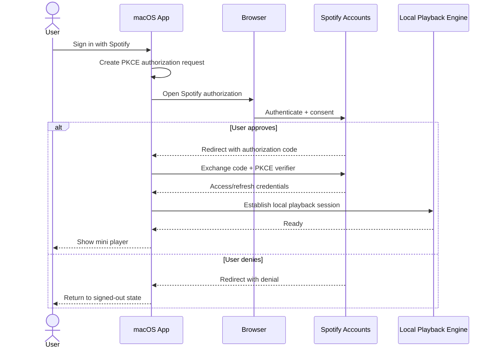

# PRD — Native macOS Spotify Mini Player

## Executive summary

Build a **native macOS Spotify mini player**: a focused, aesthetically polished menu-bar app that plays Spotify audio **locally on the Mac** rather than acting as a remote control for another Spotify client.

Mooziac is the UX reference, not the product template. Its strongest ideas are the menu-bar-first form factor, compact playback surface, artwork-driven presentation, seekable progress visualization, direct keyboard controls, and low-friction access to playback. citeturn19view0turn19view2 The new app narrows that concept to Spotify and replaces a browser/Electron playback dependency with a native Swift application backed by a local Spotify playback capability.

**Product contract**

> Click menu-bar item → see what is playing → control it immediately → audio comes from this Mac.

Playback should be exposed to the Swift app through a small native-facing playback interface backed by **librespot or an equivalent local playback provider**. librespot is specifically suitable for evaluation because it is a Spotify client library capable of playing music and functioning as a Spotify Connect receiver; it requires Spotify Premium. citeturn19view3 Its current OAuth crate supports Authorization Code with PKCE and documents that a sufficiently scoped access token can establish a librespot session and can also be used with Spotify's Web API. citeturn19view5

Spotify's Web API should complement local playback for account/library/catalog operations. It **must not become the core playback path**, because its Player endpoints operate on an active Spotify device and would turn this product into a remote controller. Spotify continues to expose Web API endpoints for remote play, pause, seek, device transfer, volume, queue, and playback state, but these are explicitly outside the MVP's primary playback contract. citeturn17view4

The implementation brief for a coding agent is therefore:

**Swift/macOS UI → app-domain interfaces → local librespot-backed playback**, with Spotify OAuth/Web API used only where a first-party API is appropriate.

## Product scope and assumptions

### Goals

The app shall:

1. Play Spotify music directly through the Mac running the app.
2. Make the most common playback actions available in one interaction from the menu bar.
3. Feel like a macOS utility rather than a reduced web application.
4. Preserve a stable Swift-facing product model regardless of how librespot is bound internally.
5. Keep the primary player visually calm: current track first, transport controls second, secondary actions subordinate.
6. Require minimal Spotify permissions and explain any additional permission when its feature is introduced.

Mooziac validates the basic interaction model: it is a native Swift/AppKit menu-bar player with a compact three-row UI, drag seeking, adaptive artwork-derived presentation, native animations, keyboard shortcuts, and a system Now Playing integration in its project structure. citeturn19view0turn19view2 This PRD intentionally does **not** copy its YouTube Music bridge, local-file system, trackpad edge controls, lyrics stack, downloads, Discord integration, or other ancillary features.

### Explicit assumptions

| ID | Assumption |
|---|---|
| A1 | **Spotify Premium is required for playback.** librespot explicitly supports Premium only. citeturn19view3 |
| A2 | MVP supports **music tracks**. Podcasts, audiobooks, shows, and episodes are v1+. |
| A3 | The Mac's local playback session is authoritative for play state, position, volume, current item, and errors. |
| A4 | One Spotify account can be authenticated at a time. |
| A5 | The primary surface is a **menu-bar mini player**. A persistent/detached floating player is v1+. |
| A6 | No Spotify audio downloading or offline-library feature is included. |
| A7 | No Electron or browser-based player is embedded for playback. Browser presentation is permitted only for Spotify's interactive OAuth authorization step. PKCE itself requires an interactive browser flow. citeturn19view5 |
| A8 | Authorization uses Spotify Authorization Code + PKCE. Spotify recommends PKCE for clients that cannot safely hold a client secret, and its current developer guidance tells client-side integrations to use PKCE rather than the deprecated implicit flow. citeturn17view2 |
| A9 | The app requests only scopes needed by enabled features; it does not pre-request a broad "future feature" scope set. This follows Spotify's current guidance. citeturn17view2 |
| A10 | en-US is the initial shipping language, but every user-visible string is localization-ready. |
| A11 | Product analytics are **off unless the user explicitly opts in**. Playback history and song identity are not telemetry fields by default. |
| A12 | Spotify's February 2026 Web API changes are the endpoint baseline. In particular, new code uses the unified `/me/library` APIs rather than deprecated content-specific save/contains endpoints. citeturn16search5turn17view4 |
| A13 | Business/distribution approval for unofficial Spotify playback is a separate product gate. The librespot project itself warns that using it to connect to Spotify may violate Spotify's rules; this PRD assumes that issue is resolved before public distribution. citeturn19view4 |

### Feature priorities

| Capability | MVP | v1+ |
|---|:---:|:---:|
| Spotify sign-in / sign-out | ✓ | |
| Restore authenticated session | ✓ | |
| Local Mac Spotify playback | ✓ | |
| Menu-bar mini player | ✓ | |
| Album artwork, track, artist | ✓ | |
| Play / pause | ✓ | |
| Previous / next | ✓ | |
| Seek | ✓ | |
| Local playback volume | ✓ | |
| Save / unsave current track | ✓ | |
| System media keys / Now Playing | ✓ | |
| Keyboard controls while player is active | ✓ | |
| Loading, buffering and error states | ✓ | |
| Settings | ✓ | |
| Optional anonymous diagnostics | ✓ | |
| Shuffle / repeat | | ✓ |
| Queue / Up Next | | ✓ |
| Search Spotify | | ✓ |
| Library browsing | | ✓ |
| Playlist browsing | | ✓ |
| Spotify Connect visibility / handoff | | ✓ |
| Detached always-available mini window | | ✓ |
| Lyrics | | ✓ |
| Podcasts / episodes / audiobooks | | ✓ |
| Configurable global hotkeys | | ✓ |

Search, queue and broader library functionality deliberately follow the player rather than precede it. Spotify still exposes Search and metadata endpoints, although its February 2026 changes reduced Search's maximum `limit` to 10 and removed several bulk/catalog endpoints, reinforcing the value of keeping MVP independent of a large browsing surface. citeturn17view4

## Experience and functional requirements

### Core player

The mini player opens from the menu-bar item and displays one coherent playback surface.

**Default composition**

```text
┌────────────────────────────────────────┐
│ [Artwork]  Track title             ♡   │
│            Artist                      │
│                                        │
│       ◀︎        ▶︎/Ⅱ        ▶︎          │
│                                        │
│  1:24  ━━━━━━━━━●━━━━━━━━━━  3:48      │
│  🔊 ━━━━━━━●                     •••   │
└────────────────────────────────────────┘
```

Exact geometry is a design decision, not a fixed implementation requirement. The information hierarchy is fixed: **identity → transport → progress → secondary controls**.

Artwork may subtly inform the visual treatment, borrowing Mooziac's adaptive-palette idea, but text/control legibility must never depend on sampled artwork colors. Mooziac demonstrates both artwork-adaptive color and compact drag-seek interactions as viable menu-bar-player patterns. citeturn19view0

### Main interaction requirements

**Open player.** Clicking the menu-bar item opens the player. Opening it must not alter playback.

**Play / pause.** The primary transport control reflects authoritative local playback state. User action changes the local session, not a separate Spotify client.

**Previous.** Invokes previous-track behavior supplied by the current playback context. Disabled only when the engine explicitly reports it unavailable.

**Next.** Advances the local playback context.

**Seek.** The progress control shows elapsed versus duration. Dragging or clicking a seekable position requests an absolute target position. During user interaction, the UI shows the proposed position; after submission, authoritative engine state wins.

**Volume.** Controls application playback volume. It must not silently modify global macOS output volume.

**Save.** Heart/save state represents the current item's Spotify-library state. Pressing it optimistically reflects the requested state but must reconcile with the provider response. Spotify's current unified library interfaces are `PUT /me/library`, `DELETE /me/library`, and `GET /me/library/contains`; the contains endpoint accepts Spotify URIs. citeturn16search13turn17view4

**Keyboard.** At minimum while the mini player has focus: `Space` toggles play/pause and left/right transport commands are keyboard reachable. Mooziac uses Space for play/pause, Command-Right/Left for next/previous, and `L` for like/unlike; those conventions are a useful precedent, but shortcuts must not override standard macOS text-field behavior. citeturn19view2

**System media controls.** Play/pause, previous, next, current metadata, artwork, elapsed time, and duration must stay synchronized with macOS's Now Playing/media-control surface.

### Main UI state flow

```mermaid
stateDiagram-v2
    [*] --> SignedOut

    SignedOut --> Authenticating: Sign in
    Authenticating --> ReadyIdle: Auth success
    Authenticating --> AuthError: Denied / failed
    AuthError --> Authenticating: Retry
    AuthError --> SignedOut: Cancel

    ReadyIdle --> Loading: Playable item requested
    Loading --> Playing: Audio starts
    Loading --> PlaybackError: Load fails

    Playing --> Paused: Pause
    Paused --> Playing: Resume

    Playing --> Loading: Next / previous / item change
    Paused --> Loading: Item change

    Playing --> Seeking: User seeks
    Paused --> Seeking: User seeks
    Seeking --> Playing: Seek committed; playing
    Seeking --> Paused: Seek committed; paused

    Playing --> Buffering: Playback stalls
    Buffering --> Playing: Recovered
    Buffering --> PlaybackError: Cannot recover

    PlaybackError --> Loading: Retry
    PlaybackError --> ReadyIdle: Dismiss / unavailable

    ReadyIdle --> SignedOut: Sign out
    Playing --> SignedOut: Sign out
    Paused --> SignedOut: Sign out
```



### UI component contract

| Component | Required props/input | Local UI state | User actions |
|---|---|---|---|
| `MenuBarItem` | auth state, playback phase | open/closed | open player |
| `MiniPlayer` | `PlaybackState`, `Track?`, account state | none beyond presentation | routes commands |
| `ArtworkView` | image, title fallback | image loading / unavailable | none |
| `TrackIdentity` | title, artists, explicit flag | truncation/tooltip | v1+: open details |
| `TransportControls` | playing, canPrevious, canNext | command pending | previous, toggle, next |
| `ProgressControl` | position, duration, seekable | dragging, preview position | seek |
| `VolumeControl` | volume, mutable | dragging | set volume |
| `SaveButton` | saved state, allowed | pending mutation | save / remove |
| `StatusIndicator` | loading/buffering/error state | none | retry where applicable |
| `OverflowMenu` | session/account capability | open/closed | settings, sign out, quit |
| `AuthView` | auth phase/error | none | sign in, retry |
| `SettingsView` | preferences/account/privacy | edited preference | change setting, sign out |

Interactive state must not be encoded solely through icon color. Playing/paused, saved/unsaved, disabled, buffering, and error conditions need distinguishable semantics for keyboard and assistive-technology users as well as visual users.

### State presentation rules

| State | Required presentation | Controls |
|---|---|---|
| Signed out | App mark + "Sign in with Spotify" | Sign in, Settings, Quit |
| Authenticating | Compact progress + "Finish signing in in your browser" | Cancel |
| Idle/no track | Neutral empty state | Playback disabled |
| Loading track | Metadata skeleton/known metadata + loading indicator | Cancel unnecessary; transport temporarily guarded |
| Buffering | Preserve artwork/metadata; show unobtrusive buffering state | Pause remains available when meaningful |
| Playing | Full current-track state | All supported controls |
| Paused | Same layout; explicit paused transport state | Resume + seek etc. |
| Seeking | Immediate scrub preview | Other state remains stable |
| Playback error | Preserve track if known; actionable error | Retry / dismiss as applicable |
| Auth expired | Playback stopped if session cannot recover; reauth prompt | Reconnect |
| Offline/network lost | Keep known track UI; explain connectivity failure | Retry once connectivity returns |
| Unsupported item | Identify item if possible; explain it cannot play | Skip / dismiss |
| Premium required | Explain Premium requirement | Account/sign-out actions |

## Product contracts and data

The app should expose provider-independent domain contracts to the UI. The product requirement is the interface behavior below; whether a modern Swift binding uses generated foreign-function interfaces, a thin C-compatible boundary, or another interop mechanism is intentionally outside this PRD.

librespot already separates OAuth, playback and metadata concerns in its project and can directly play Spotify through its audio backends; on macOS its default Rodio configuration is documented as buildable without Linux-specific audio dependencies. citeturn19view3turn19view4 This makes a narrow Swift-facing provider contract preferable to leaking Rust/librespot-specific concepts throughout the UI.

### Domain interfaces

```swift
protocol AuthService {
    var state: AuthState { get }

    func signIn() async throws -> AuthSession
    func restoreSession() async -> AuthSession?
    func signOut() async
}

protocol PlaybackEngine {
    var state: PlaybackState { get }

    func start(_ request: PlayRequest) async throws
    func resume() async throws
    func pause() async throws
    func previous() async throws
    func next() async throws
    func seek(to milliseconds: Int64) async throws
    func setVolume(_ value: Double) async throws
}

protocol MetadataService {
    func track(for uri: SpotifyURI) async throws -> Track
}

protocol LibraryService {
    func savedState(for uri: SpotifyURI) async throws -> Bool
    func save(_ uri: SpotifyURI) async throws
    func remove(_ uri: SpotifyURI) async throws
}
```

These are **behavioral API contracts**, not an implementation prescription. Playback commands target the app's local playback engine. Spotify's remote Player REST endpoints are not invoked by these methods in MVP.

### Core models

```text
AuthState =
  signedOut
  authenticating
  signedIn
  refreshing
  needsReauthentication
  error

AuthSession
  accountID: String?
  displayName: String?
  grantedScopes: Set<Scope>
  expiresAt: Date?
  status: AuthState

Track
  uri: SpotifyURI
  title: String
  artists: [ArtistSummary]
  albumTitle: String?
  artwork: Artwork?
  durationMs: Int64
  explicit: Bool
  isSaved: Bool?

PlaybackState
  phase: PlaybackPhase
  currentTrack: Track?
  positionMs: Int64
  durationMs: Int64
  volume: Double
  canSeek: Bool
  canPrevious: Bool
  canNext: Bool
  error: PlayerError?

PlaybackPhase =
  idle | loading | buffering | playing | paused | ended | error

PlayRequest
  uri: SpotifyURI
  contextURI: SpotifyURI?
  startPositionMs: Int64?

PlayerPreferences
  appearance: system | light | dark
  launchAtLogin: Bool
  showArtworkInMenuBar: Bool
  diagnosticsConsent: Bool
```

Do not duplicate authorization tokens in general UI/domain models. The UI needs auth status, account identity, scopes and expiry/reconnect state—not raw secrets.

librespot's current metadata crate exposes track, album, artist, playlist, episode, show and lyrics types, so the domain can extend to richer Spotify entities later without requiring those entities in the MVP model. citeturn13view3

### External APIs and provider boundaries

| Area | Contract / endpoint | Use | MVP |
|---|---|---|:---:|
| Auth | Spotify authorization endpoint | Interactive consent + authorization code | ✓ |
| Auth | `POST /api/token` | Code exchange / token lifecycle | ✓ |
| Local playback | `PlaybackEngine.start/resume/pause` | **Native Mac playback** | ✓ |
| Local playback | `previous/next/seek/setVolume` | **Native Mac controls** | ✓ |
| Playback events | `PlaybackState` stream/observation | Authoritative current state | ✓ |
| Metadata | librespot metadata and/or `GET /v1/tracks/{id}` | Current track metadata | ✓ |
| Library | `GET /v1/me/library/contains?uris=…` | Saved state | ✓ |
| Library | `PUT /v1/me/library` | Save item | ✓ |
| Library | `DELETE /v1/me/library` | Remove item | ✓ |
| Profile | `GET /v1/me` | Optional display identity only | Optional |
| Search | `GET /v1/search` | Search surface | v1+ |
| Queue | local engine queue contract | Local Up Next | v1+ |
| Spotify account playback | `GET /v1/me/player` | Cross-device account state | v1+ only |
| Spotify remote control | `/v1/me/player/*` mutation endpoints | External-device control/handoff | **Not core MVP** |

Spotify's February 2026 API update introduced the generic library endpoints and removed the old content-specific save/remove/contains methods in favor of `/me/library`; it kept single-track metadata, Search, profile, and Player endpoints available. citeturn17view4 Spotify also publishes a machine-readable OpenAPI specification specifically so clients and coding agents can avoid guessing endpoint or schema details; generated code should treat that current specification as canonical. citeturn17view2

**Important source-of-truth rule:** never poll `GET /me/player` to decide whether this app's local audio is playing. For MVP, `PlaybackEngine.state` is authoritative. The Web API Player surface describes Spotify account/device playback and is therefore a different responsibility. Spotify's current Player API includes device discovery, transfer, playback state, play/pause, seek, next/previous, shuffle, repeat and volume controls. citeturn17view4

## Authentication, permissions, errors, and privacy

### Authentication flow

Spotify's current guidance is well aligned with a native desktop client: Authorization Code with PKCE avoids embedding a client secret. The redirect URI must exactly match a registered redirect except that loopback IP redirects may use a dynamically assigned port; Spotify currently permits HTTP for explicit loopback IP literals such as `127.0.0.1`, while `localhost` is not accepted. citeturn17view3 librespot OAuth 0.8.0 independently documents PKCE, token refresh support, browser interaction, loopback callback capture, and use of its resulting token for either Spotify's Web API or a librespot session. citeturn19view5



### Permission model

The coding agent must derive the exact current provider scope set from the current librespot/Spotify contracts rather than copy an old hard-coded scope bundle. Spotify explicitly recommends minimum-scope authorization and warns AI-generated integrations to cross-check current documentation rather than guess fields or endpoints. citeturn17view2

Product-level scope requirements are:

| Capability | Permission rule |
|---|---|
| Local playback | Request only scopes required by the selected current librespot playback/auth flow |
| Read saved status | Add `user-library-read` |
| Save / unsave | Add `user-library-modify` |
| Profile identity | Request profile permission only if profile UI ships |
| Spotify remote playback | Do **not** request remote-playback scopes for MVP |
| Playlist editing | Do not request until playlist editing ships |

The app must not rely on `/me`'s `product` field to determine Premium status: Spotify removed the `product` field from the User object in its February 2026 API changes. Premium eligibility should instead be represented as a playback/auth capability outcome, with a clear "Spotify Premium required" error when applicable. citeturn17view4turn19view3

### Error taxonomy

| Error | User-facing behavior | Retry |
|---|---|---|
| `authDenied` | Return to sign-in; "Spotify access wasn't granted." | Manual |
| `authExpired` | "Reconnect Spotify" without destroying preferences | User action |
| `invalidCallback` | End auth attempt; offer Sign In Again | Manual |
| `premiumRequired` | Explain that local playback requires Premium | After account change |
| `networkUnavailable` | Preserve known UI; "You're offline" | Automatic + manual |
| `serviceUnavailable` | Preserve track/context; generic service failure | Manual/automatic |
| `trackUnavailable` | "This track isn't available." | Next / dismiss |
| `loadFailed` | Keep metadata if known; expose Retry | Manual |
| `playbackSessionLost` | Reconnect local session; don't pretend playback continues | Automatic, then manual |
| `seekFailed` | Snap position back to authoritative state | Manual on next gesture |
| `libraryMutationFailed` | Revert optimistic heart state; non-blocking message | Manual |
| `insufficientScope` | Explain affected feature; initiate consent only when needed | Reauthorize |
| `rateLimited` | Do not repeatedly retry; show operation as temporarily unavailable | Provider-directed |
| `unknown` | Concise generic failure + Retry; optional diagnostic details | Manual |

Spotify currently instructs API clients to handle returned HTTP errors, respect `429` rate limits and `Retry-After`, and avoid tight retry loops. citeturn17view2 Provider-specific diagnostic text must not be dumped directly into the normal UI.

### Privacy and telemetry

Mooziac takes a strict local-first position, documenting zero telemetry and local storage for playlists/history/preferences. citeturn19view0 This app should use that as the default expectation while leaving room for explicitly consensual diagnostics.

**Required behavior**

- Telemetry is **off by default**.
- Settings clearly state whether diagnostics are enabled.
- Enabling diagnostics is a deliberate user action, independent of Spotify authentication.
- Never include access tokens, refresh tokens, authorization codes, account email, raw credentials, or authentication blobs.
- Default diagnostic events do not contain song title, artist, album, Spotify URI, listening history, or search text.
- An error-report action may show exactly what diagnostic information will be submitted before submission.
- Sign Out revokes/removes the app's locally retained authentication session.
- Reset App Data removes preferences and locally retained application state after confirmation.

Suggested opt-in events are product events rather than listening analytics: `app_launch`, `auth_result`, `playback_start_result`, `playback_error_category`, `library_action_result`, and `settings_changed`, with no content identifiers attached.

## Accessibility, localization, and settings

### Accessibility requirements

The mini player's visual minimalism cannot reduce operability.

Every actionable control must:

- be reachable using keyboard navigation;
- expose a meaningful accessibility label and current value/state;
- expose disabled state;
- make play versus pause, saved versus unsaved, and buffering/error status understandable without relying on color;
- provide an accessible seek control reporting elapsed/current value and duration;
- provide an accessible volume value;
- expose title and artist as separate readable metadata;
- keep controls understandable when artwork is missing;
- honor macOS appearance/accessibility settings rather than baking state into artwork-derived styling;
- avoid essential auto-advancing or decorative motion when the user requests reduced motion.

The player should remain semantically usable with VoiceOver even if artwork, animation, adaptive color and other aesthetics are entirely unavailable. Apple's HIG treats accessibility as a first-class platform design concern, and its native accessibility APIs expose content to assistive technologies including VoiceOver. citeturn19view7turn18search13

Mooziac's adaptive artwork palette is therefore inspiration rather than a state channel: artwork-derived color can enrich the player, but semantic state and legibility must remain independent of it. citeturn19view0

### Localization hooks

All user-visible text must originate from localization resources from the first implementation.

Localize:

- control labels and accessibility labels;
- error messages and recovery actions;
- authentication copy;
- settings labels/descriptions;
- pluralized queue counts in v1+;
- elapsed/duration accessibility text;
- privacy/diagnostics descriptions;
- menu commands.

Do not localize:

- Spotify URIs/IDs;
- internal enum values;
- log keys;
- analytics event identifiers.

UI components must tolerate localized strings longer than en-US without truncating the only explanation of an error or action. Track/artist metadata is provider content and is displayed as received.

### Settings surface

Keep Settings narrow.

| Section | MVP setting | Default |
|---|---|---|
| Account | Spotify identity/status; Sign Out | — |
| General | Launch at Login | Off |
| Appearance | System / Light / Dark | System |
| Menu Bar | Show artwork in menu-bar item | Off |
| Playback | Current playback/account readiness; no remote-device selector | — |
| Keyboard | Show supported shortcuts | — |
| Privacy | Share anonymous diagnostics | Off |
| Privacy | View diagnostic-data description | — |
| Data | Reset App Data | — |
| About | Version, licenses, Spotify/librespot attribution | — |

v1+ may add detached-player behavior, configurable shortcuts, Spotify Connect device visibility, shuffle/repeat defaults, and richer playback preferences. librespot already exposes configuration concepts such as device identity, initial volume and volume normalization, but those options should become user settings only when they solve a validated product need rather than mirroring backend switches. citeturn19view4

## Acceptance criteria

A coding agent should consider MVP complete only when the following observable behaviors pass. These criteria intentionally test product behavior rather than internal architecture.

### Authentication and session

| ID | Acceptance criterion |
|---|---|
| AUTH-01 | Fresh launch without credentials shows a signed-out mini-player state and one clear Spotify sign-in action. |
| AUTH-02 | Sign-in opens Spotify authorization through Authorization Code + PKCE; no client secret is required in the installed app. Spotify's current client-side guidance specifies PKCE for this case. citeturn17view2 |
| AUTH-03 | A successful callback transitions to an authenticated local playback-ready state without requiring the official Spotify desktop app to run. |
| AUTH-04 | Denying authorization returns cleanly to Signed Out. |
| AUTH-05 | A valid prior session restores on relaunch without interactive sign-in. |
| AUTH-06 | An expired but recoverable token is refreshed without interrupting the user. librespot's OAuth client documents token refresh support. citeturn19view5 |
| AUTH-07 | Unrecoverable credentials show Reconnect Spotify rather than an indefinite spinner. |
| AUTH-08 | Sign Out stops the local session and removes locally retained account credentials. |
| AUTH-09 | Non-Premium playback failure is represented as `premiumRequired`, not a generic unknown error, because librespot requires Premium. citeturn19view3 |

### Playback

| ID | Acceptance criterion |
|---|---|
| PLAY-01 | Playback audio originates from the app's local Mac playback engine; it does not depend on the official Spotify desktop client. |
| PLAY-02 | Play, pause, previous and next operate on the local session. |
| PLAY-03 | UI play state always converges to authoritative engine state after a command succeeds or fails. |
| PLAY-04 | Current title, artist, artwork, duration and progress update when the current item changes. |
| PLAY-05 | Seeking changes the current local track position and reconciles to the engine-reported position. |
| PLAY-06 | Volume changes the app playback volume without unexpectedly changing system output volume. |
| PLAY-07 | Buffering does not erase current metadata. |
| PLAY-08 | A failed item load produces a recoverable error rather than leaving the player indefinitely loading. |
| PLAY-09 | macOS media play/pause and track controls operate the same local playback session. |
| PLAY-10 | System Now Playing metadata and app metadata refer to the same current track. |
| PLAY-11 | Closing the menu-bar popover does not stop playback. |
| PLAY-12 | `GET /me/player` or equivalent remote-account polling is not required for local playback correctness. Spotify's Web API Player endpoints remain a separate remote-device capability. citeturn17view4 |

### Library

| ID | Acceptance criterion |
|---|---|
| LIB-01 | Opening a track resolves its saved/unsaved state when permission is available. |
| LIB-02 | Save uses the current unified Spotify Library API rather than deprecated track-specific save endpoints. citeturn16search5turn17view4 |
| LIB-03 | Unsave uses the current unified removal endpoint. citeturn17view4 |
| LIB-04 | Failed save/unsave returns the heart to authoritative state and gives non-blocking feedback. |
| LIB-05 | The app does not request library-write permission when the save feature is disabled or absent. |

### Player UI

| ID | Acceptance criterion |
|---|---|
| UI-01 | One menu-bar action exposes current-track identity and primary transport controls. |
| UI-02 | Player has distinct signed-out, authenticating, idle, loading, buffering, playing, paused and error presentations. |
| UI-03 | Play/pause is the visually dominant transport action. |
| UI-04 | Long track/artist names never cover transport or progress controls. |
| UI-05 | Missing artwork yields a deliberate placeholder rather than a broken-image state. |
| UI-06 | Artwork-driven styling cannot make text or controls unreadable. |
| UI-07 | Every disabled control corresponds to an unavailable capability/state rather than being merely decorative. |
| UI-08 | The interface remains fully usable without animation or artwork-derived color. |
| UI-09 | `Space` performs play/pause when the player itself owns keyboard focus and no text editor has precedence. |
| UI-10 | Opening Settings does not interrupt playback. |

### Errors and recovery

| ID | Acceptance criterion |
|---|---|
| ERR-01 | Loss of network produces a defined offline/service state, not a crash or permanent spinner. |
| ERR-02 | Restored connectivity allows a recoverable playback/session action without requiring app restart. |
| ERR-03 | Auth, network, Premium, unavailable-item, playback-session, rate-limit and unknown failures remain distinguishable. |
| ERR-04 | API `429` handling respects provider retry instructions rather than issuing an immediate retry loop, matching Spotify's current guidance. citeturn17view2 |
| ERR-05 | Provider/internal error text cannot expose credentials or raw secret values to normal UI. |

### Accessibility, localization, and privacy

| ID | Acceptance criterion |
|---|---|
| A11Y-01 | Every playback action can be performed without a pointer. |
| A11Y-02 | VoiceOver identifies artwork context, title, artist, play/pause, previous, next, seek, volume, saved state and menu actions meaningfully. |
| A11Y-03 | VoiceOver announces play/pause and save-state changes rather than relying on visual icon replacement alone. |
| A11Y-04 | Seek and volume report meaningful values to assistive technology. |
| A11Y-05 | High-contrast/reduced-motion/system appearance preferences do not make core controls unusable. |
| LOC-01 | No MVP user-facing product string is hard-coded outside localization resources. |
| LOC-02 | en-US strings are complete and localization keys remain stable. |
| PRIV-01 | Diagnostics are disabled on fresh install. |
| PRIV-02 | Spotify sign-in cannot implicitly enable diagnostics. |
| PRIV-03 | Default diagnostic payloads contain no listening-history or track-identifying data. |
| PRIV-04 | Sign Out removes retained authentication state while preserving unrelated preferences unless the user chooses Reset App Data. |
| PRIV-05 | Reset App Data requires confirmation and returns the app to its fresh-install signed-out state. |

The resulting MVP is intentionally narrow: **authenticate, play Spotify locally, show excellent Now Playing information, control playback instantly, and stay native to macOS**. That preserves Mooziac's strongest product idea—the low-friction menu-bar music surface—while making local Spotify playback rather than a web client or remote-control layer the defining capability. Mooziac's current implementation demonstrates the value of compact menu-bar playback and direct keyboard interaction; librespot provides the local Spotify client capability; and Spotify's current platform documentation supplies PKCE plus narrowly scoped library/metadata APIs around that playback core. citeturn19view0turn19view3turn19view5turn17view2