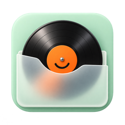
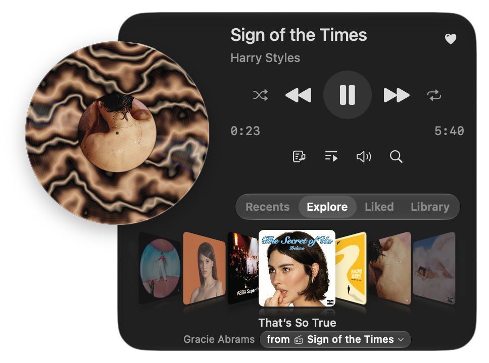

<p align="center">
  
</p>

<h1 align="center">Bopify</h1>

<p align="center">A Spotify player for your Mac, tucked into the menu bar.</p>

<p align="center">
  <a href="https://leesiongchan.github.io/bopify/">Website</a> ·
  <a href="https://github.com/leesiongchan/bopify/releases">Download</a>
</p>

Play music with a spinning record, browse your library and queue, search Spotify, and read lyrics. Supports Spotify Connect and keyboard shortcuts.

<p align="center">
  
</p>

## Get started

Requires **macOS 26+**, **Apple silicon**, and **Spotify Premium**.

1. [Download Bopify](https://github.com/leesiongchan/bopify/releases), open the DMG, and drag the app to Applications.
2. Open Bopify and sign in to Spotify.
3. Follow setup to create a [Spotify Developer app](https://developer.spotify.com/dashboard) with **Web API** access and redirect URI `http://127.0.0.1:8898/callback`. Add your Spotify account under **Users and Access** if requested.
4. Paste the **Client ID** into Bopify and authorize access.
5. Follow the setup link to get your **Soloist key**, paste it into Bopify, and continue. When prompted, open Spotify on the same network, select Bopify's device, and play a track to pair.

Bopify installs and updates Soloist automatically and remembers your pairing.

Releases are ad-hoc signed and not notarized. If macOS blocks the app, approve it in **System Settings → Privacy & Security**.

## How it works

Bopify uses SwiftUI and AppKit for its native macOS interface.

- **Playback:** Spotify Soloist runs as a managed local process, controlled over a local WebSocket.
- **Library and search:** Spotify's Web API uses the app registration you create during setup.
- **Metadata:** A Rust bridge uses a separate librespot session for lyrics, radio, and artist tracks. Lyrics fall back to LRCLIB when Spotify is unavailable.

## Build

Install Xcode, Rust, and [mise](https://mise.jdx.dev/), then run:

```sh
mise install
./scripts/build-rust.sh
open Bopify/Bopify.xcodeproj
```

Run the **Bopify** scheme. Keep the same Apple Development signing identity across builds to reduce Keychain prompts.

Run checks after building the Rust framework:

```sh
./scripts/test-native.sh
swift test --package-path Packages/BopifyCore
```
