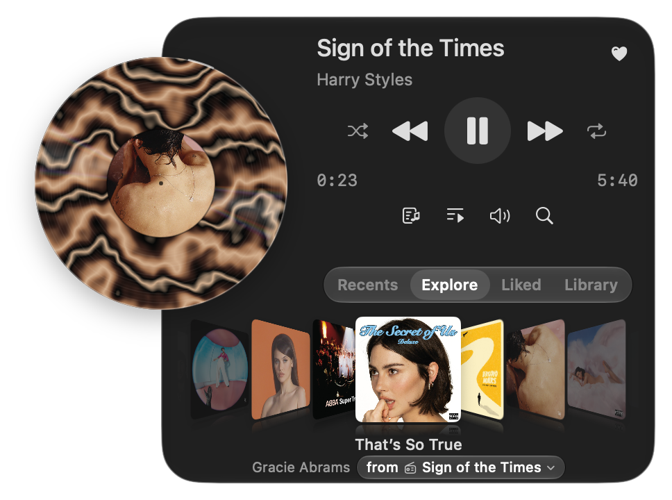

<p align="center">
  
</p>

<h1 align="center">Bopify</h1>

<p align="center">A Spotify player for your Mac, tucked into the menu bar.</p>

<p align="center"><a href="https://leesiongchan.github.io/bopify/">Website</a></p>

Play music with a spinning record, browse your library and queue, search Spotify, and follow along with lyrics. Bopify also supports Spotify Connect and keyboard shortcuts.

<p align="center">
  
</p>

## Get started

Bopify requires **macOS 26 or later**, an **Apple silicon Mac**, and **Spotify Premium**.

1. Download Bopify from [Releases](https://github.com/leesiongchan/bopify/releases), open the DMG, and drag Bopify to Applications.
2. Open Bopify from the menu bar and sign in to Spotify.
3. Create an app in the [Spotify Developer Dashboard](https://developer.spotify.com/dashboard). Add `http://127.0.0.1:8898/callback` as a redirect URI and select **Web API**.
4. In the app's **User Management**, add your Spotify account's name and email. Copy the **Client ID** into Bopify and authorize library access.

The release build is ad-hoc signed and not notarized; macOS may require you to approve opening it in Privacy & Security.

## Build from source

Install Xcode, Rust, and [mise](https://mise.jdx.dev/), then run:

```sh
mise install
./scripts/build-rust.sh
open Bopify/Bopify.xcodeproj
```

Select the Bopify scheme in Xcode and run it. The build script creates the Rust library required by the Swift package.

## Releases

Pushes to `main` release automatically when they bring user-facing app changes: a `feat:`, `fix:`, `perf:`, `revert:`, or breaking Conventional Commit touching the shipped app inputs listed in `cliff.toml`. Website, documentation, agent instructions, and test-only changes never release the app, and other commit types such as `chore:`, `refactor:`, and `build:` wait for the next release.

`feat:` bumps the minor version, `fix:`, `perf:`, and `revert:` (including git's default `Revert "…"` message of a user-facing commit) bump the patch, and `!` or a `BREAKING CHANGE:` footer bumps the major. To ship a dependency update on its own, commit it as `fix(deps):`. Release notes list user-facing commit subjects since the last release and keep breaking upgrade instructions.

## License

[MIT](LICENSE)
