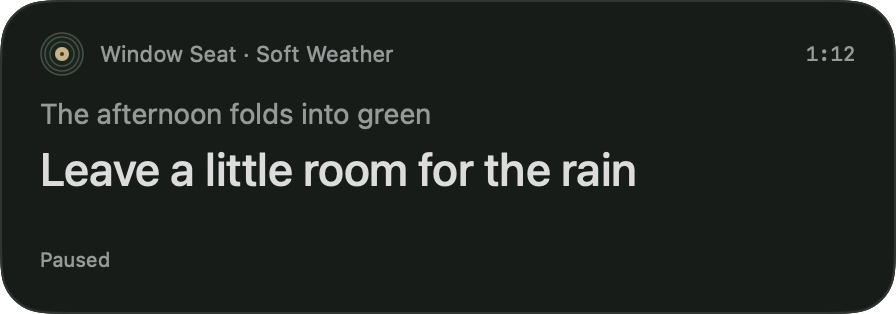
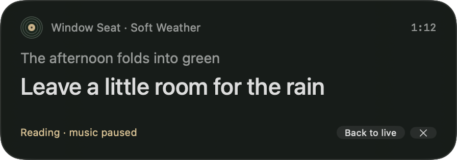
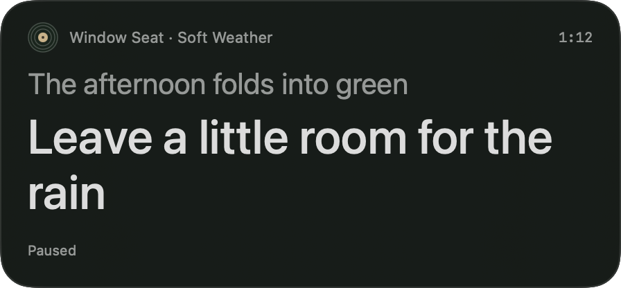

# Native lyric ribbon study validation

Validated October 17, 2026 on Apple Silicon with Xcode 27.0. This is the Debug-only, original-fixture study described in the [approved design](superpowers/specs/2026-10-17-lyric-ribbon-design.md). It does not load real lyrics or observe Spotify playback.

## Automated checks

The complete `BopifyAppTests` run passed: **46 tests across 7 suites**, including 26 lyric timeline, reading, layout, panel and preview tests. Debug and Release app builds both succeeded. Release binary inspection found no lyric study symbols or `--lyric-ribbon-preview` launch flag.

Tests cover timestamp boundaries, simultaneous and repeated cues, invalid input, explicit gaps, unknown duration, pause, correction versus seek, held text at playback end, same-recording occurrence replacement, session replacement, stale load completion, hide/reopen behavior, late clock ticks after cancellation, bounded text measurement, reachable frame recovery and explicit keyboard actions. No playback engine is supplied to the lyric model or session.

Commands, run from the repository root:

```sh
xcodebuild -project Bopify/Bopify.xcodeproj -scheme BopifyAppTests \
  -configuration Debug -destination 'platform=macOS,arch=arm64' \
  -derivedDataPath build/lyric-ribbon-study CODE_SIGNING_ALLOWED=NO test
xcodebuild -project Bopify/Bopify.xcodeproj -scheme Bopify \
  -configuration Debug -destination 'platform=macOS,arch=arm64' \
  -derivedDataPath build/lyric-ribbon-study CODE_SIGNING_ALLOWED=NO build
xcodebuild -project Bopify/Bopify.xcodeproj -scheme Bopify \
  -configuration Release -destination 'platform=macOS,arch=arm64' \
  -derivedDataPath build/lyric-ribbon-study CODE_SIGNING_ALLOWED=NO build
```

## Native interaction checks

| Check | Observed result |
| --- | --- |
| Original timed sample | Current and previous cues render on the charcoal surface with a small vinyl mark |
| Hold at 1:12 and advance to 1:27 | Passage remains at 1:12; elapsed time reaches 1:27 |
| Back to live | Immediately displays the 1:27 cue, without intermediate cue animation |
| Passive first click | Actual pointer click on Hold text succeeds while TextEdit remains the front app |
| Typing focus | Markers typed into a temporary TextEdit document before and after Hold text, Back to live and header dragging remain in that document |
| Explicit keyboard interaction | Focus Ribbon reveals controls; Tab cycles reading/hide, Space holds text, Escape hides the ribbon |
| Long passage | Wraps and scrolls within a height bounded by the screen, with header/footer outside the text area |
| Larger text | Scale 1.5 increases reserved height and wraps the current line without truncation |
| Right-to-left sample | Arabic text shapes and wraps in the native text view; the original logical text is exposed through accessibility |
| Plain sample | Ordinary text reading, with no Live label or Hold text action |
| Accessibility structure | Track, elapsed time, lyric text area, status and intentional reading/hide controls are exposed |
| Window placement | Movable independently of the main player; separate preview frame preference |

Native testing caught and corrected first-click rejection, hidden controls in explicit keyboard mode and repeated-show scroll resets. Regression tests cover the affected policies and state transitions. The explicit keyboard loop works without changing the user's system-wide button navigation preference. Apple's focus guidance explains that ordinary button tabbing depends on that preference. [Apple SwiftUI focus cookbook](https://developer.apple.com/videos/play/wwdc2023/10162/).

## Visual evidence

The native surface retains the approved browser study's compact silhouette, dark vinyl palette, rounded edge and text hierarchy. Native system text is slightly different from browser text rendering; previous and current cues remain visually distinct. Larger text grows the reserved viewport rather than clipping the line.







## Remaining manual coverage

VoiceOver speech/navigation, fullscreen Spaces, physical display disconnection, and changed system Reduce Transparency/Increase Contrast settings were not exercised end to end. Accessibility structure and display-recovery geometry were checked separately; these do not establish those broader results. The study should receive those manual checks before its native experience is treated as release-ready.

The appearance was inspected over the current desktop and a light TextEdit document. No claim is made about every desktop background or screen-sharing configuration. Live lyric sourcing, provider matching, rights and Spotify integration remain outside this increment.
