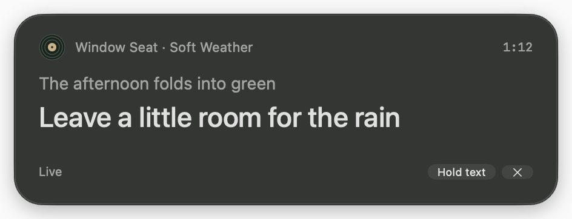
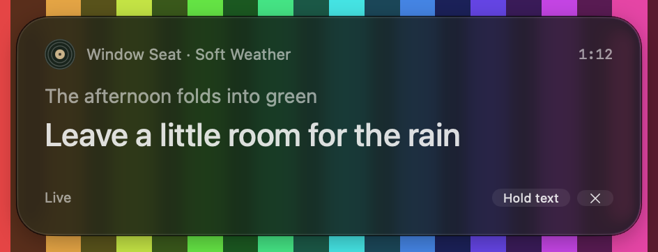

# Native lyric ribbon study validation

Validated October 17, 2026 on Apple Silicon with Xcode 27.0. This is the Debug-only, original-fixture study described in the [approved design](superpowers/specs/2026-10-17-lyric-ribbon-design.md). It does not load real lyrics or observe Spotify playback.

## Automated checks

The complete `BopifyAppTests` run passed: **51 tests across 7 suites**, including 31 lyric timeline, reading, layout, panel and preview tests. Debug and Release app builds both succeeded. Release binary inspection found no lyric study symbols or `--lyric-ribbon-preview` launch flag.

Tests cover timestamp boundaries, simultaneous and repeated cues, invalid input, explicit gaps, unknown duration, pause, correction versus seek, held text at playback end, same-recording occurrence replacement, session replacement, stale load completion, hide/reopen behavior, late clock ticks after cancellation, bounded text measurement, reachable frame recovery and explicit keyboard actions. No playback engine is supplied to the lyric model or session.

Commands, run from the repository root:

```sh
xcodebuild -project Bopify/Bopify.xcodeproj -scheme BopifyAppTests \
  -configuration Debug -destination 'platform=macOS,arch=arm64' \
  -derivedDataPath build/lyric-ribbon-study CODE_SIGNING_ALLOWED=NO test
xcodebuild -project Bopify/Bopify.xcodeproj -scheme Bopify \
  -configuration Debug -destination 'platform=macOS,arch=arm64' \
  -derivedDataPath build/lyric-ribbon-study CODE_SIGNING_ALLOWED=NO build
xcodebuild -project Bopify/Bopify.xcodeproj -scheme Bopify \
  -configuration Release -destination 'platform=macOS,arch=arm64' \
  -derivedDataPath build/lyric-ribbon-study CODE_SIGNING_ALLOWED=NO build
```

## Native interaction checks

| Check | Observed result |
| --- | --- |
| Original timed sample | Current and previous cues render on the charcoal surface with a small vinyl mark |
| Hold at 1:12 and advance to 1:27 | Passage remains at 1:12; elapsed time reaches 1:27 |
| Back to live | Immediately displays the 1:27 cue, without intermediate cue animation |
| Passive first click | Actual pointer click on Hold text succeeds while TextEdit remains the front app |
| Typing focus | Markers typed into a temporary TextEdit document before and after Hold text, Back to live and header dragging remain in that document |
| Explicit keyboard interaction | Focus Ribbon reveals controls; Tab cycles reading/hide, Space holds text, Escape hides the ribbon |
| Long passage | Wraps and scrolls within a height bounded by the screen, with header/footer outside the text area |
| Larger text | Scale 1.5 increases reserved height and wraps the current line without truncation |
| Right-to-left sample | Arabic text shapes and wraps in the native text view; the original logical text is exposed through accessibility |
| Plain sample | Ordinary text reading, with no Live label or Hold text action |
| Accessibility structure | Track, elapsed time, lyric text area, status and intentional reading/hide controls are exposed; Hold text has the stable accessible label “Hold text”, native `AXCheckBox` role and value 0 live / 1 held |
| Window placement | Movable independently of the main player; separate preview frame preference |

Native testing caught and corrected first-click rejection, hidden controls in explicit keyboard mode and repeated-show scroll resets. Regression tests cover the affected policies and state transitions. The explicit keyboard loop works without changing the user's system-wide button navigation preference. Apple's focus guidance explains that ordinary button tabbing depends on that preference. [Apple SwiftUI focus cookbook](https://developer.apple.com/videos/play/wwdc2023/10162/).

## Visual evidence

The native surface retains the approved browser study's compact silhouette, dark vinyl palette, rounded edge and text hierarchy. The approved glass follow-up replaces the standard-material background and 86%-opacity dark overlay with one regular Liquid Glass effect and a 75%-opacity charcoal-green fill. The glass supplies its own edge; the explicit border remains only for the opaque accessibility fallback. Typography, the vinyl mark, warm accents and the AppKit window/text bridges remain intact. The implementation follows Apple's [custom glass API](https://developer.apple.com/documentation/swiftui/applying-liquid-glass-to-custom-views).

Native system text is slightly different from browser text rendering; previous and current cues remain visually distinct. Larger text grows the reserved viewport rather than clipping the line. The captures below use the actual ribbon sources in a disposable native harness over owned backdrops. They capture composited screen pixels: window-only captures omit the desktop blending and misleadingly show a flat dark surface.






Dark, white and saturated patterned backdrops were inspected. The first untinted glass pass was too bright over white, so the charcoal fill was tuned for small text. A spot check of solid glyph pixels against the uniform background in the final white-backdrop capture measured approximately 4.58:1 for metadata, the previous cue and status. This is a controlled screenshot measurement, not a complete contrast audit across all desktop content.

The same native harness injected Reduce Transparency and Increased Contrast environment values without changing system preferences. Both select the opaque surface; Increased Contrast adds the stronger border. The [reduced-transparency capture](mockups/lyric-ribbon-glass-reduced-transparency.png) and [increased-contrast capture](mockups/lyric-ribbon-glass-increased-contrast.png) record those branches. System-setting propagation remains unverified end to end.

In the rebuilt app, actual pointer activation of Hold text kept TextEdit frontmost with its `AXTextArea` focused. Actual header dragging moved the panel by the requested 20 horizontal and 10 vertical points while TextEdit remained frontmost. Tab/Space returned the native reading toggle to value 0; Escape hid the ribbon and reopening succeeded. The final code passed all 51 tests and Debug/Release builds again. The focused review found no correctness issues.

## Remaining manual coverage

Fresh code review identified a display-transition issue: a long ribbon could retain a tall display's viewport after being dragged onto a shorter display. The fix remeasures through AppKit's screen-change callback and selects the destination by greatest window overlap. Deterministic tests cover overlapping screens, the tall-to-short transition and callback wiring. A real drag between the connected displays also shrank the long ribbon from 1,010 to 830 points, keeping the footer within the shorter display. The drag call itself returns immediately, so it cannot serve as a drag-completion hook. [Apple window dragging](https://developer.apple.com/documentation/appkit/nswindow/performdrag(with:)).

Both minor review items are resolved. Passage updates reuse the displayed text view's layout manager and cached height; only changed attributed text or width triggers measurement. Regression tests verify reuse across ten unchanged updates and viewport changes, preserved selection, and invalidation for new words, text scale and width. Native larger-text rendering was rechecked. AppKit provides the layout pass through [ensureLayout(for:)](https://developer.apple.com/documentation/appkit/nslayoutmanager/ensurelayout(for:)). This establishes the removed repeated work, not a live-playback performance benchmark.

Hold text now uses a native [button-style Toggle](https://developer.apple.com/documentation/swiftui/togglestyle/button), preserving the compact appearance while exposing an on/off state. Native accessibility inspection verified its stable label and 0/1 value transitions. Tab/Space activation, Escape dismissal, held text across advancing playback, immediate catch-up and actual pointer clicks preserving a scratch editor's typing focus all passed again. The screenshots above show the updated control.

VoiceOver speech/navigation, fullscreen Spaces, physical display disconnection, and changed system Reduce Transparency/Increase Contrast settings were not exercised end to end. Accessibility structure and display-recovery geometry were checked separately; these do not establish those broader results. The study should receive those manual checks before its native experience is treated as release-ready.

The appearance was inspected over the current desktop, a light TextEdit document and the controlled dark, white and patterned backdrops above. No claim is made about every desktop background or screen-sharing configuration. Live lyric sourcing, provider matching, rights and Spotify integration remain outside this increment.
