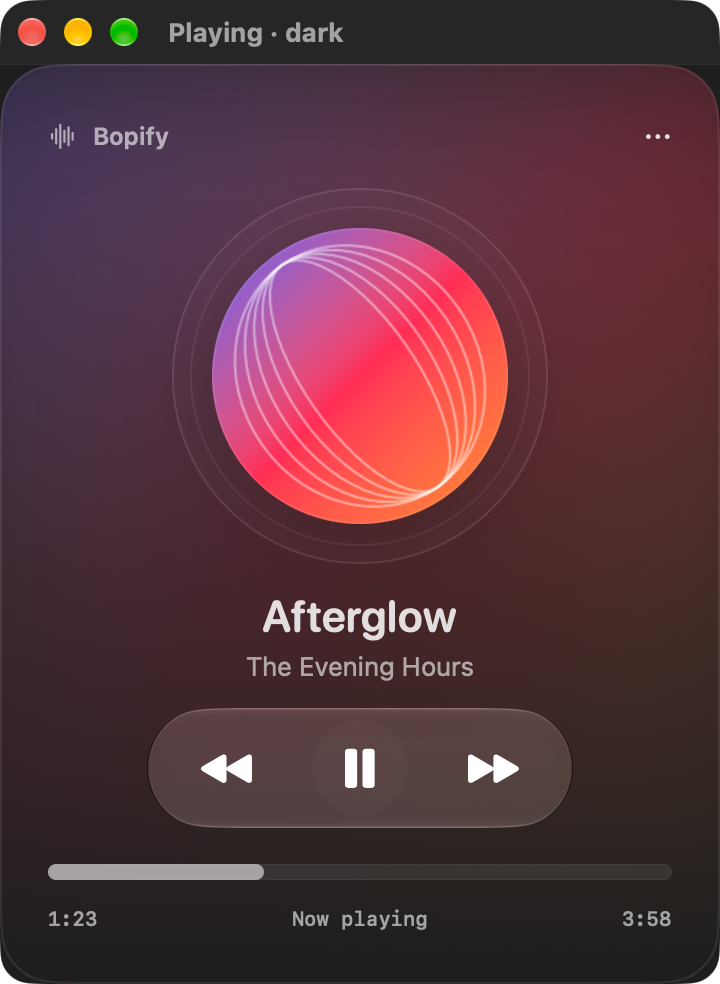
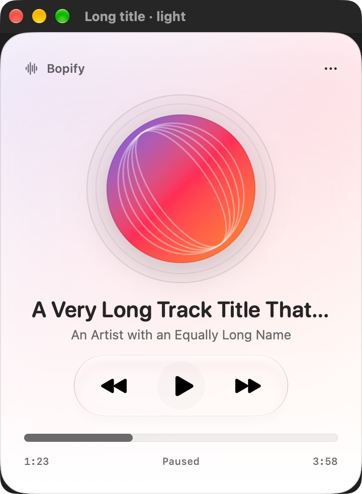

# Bopify mini-player: requirement audit and replacement design

Date: 2026-09-24
Status: approved by the user on 2026-09-24 for implementation planning; implementation is not yet approved or complete.

## Intent and scope

The supplied video and `macos_liquid_glass_music_mini_player_prompt.md` define a quiet, usable macOS music player with a strong circular composition. Success means the artwork carousel, radial playback clock, and transformation into a queue work together during real playback. All artwork stays front-facing. The deliverable contains only the native player UI.

This redesign builds on Bopify's local librespot playback and existing uncommitted SwiftUI work. It retains authentication, lifecycle serialization, event-authoritative playback, localization, loading/error handling, and useful accessibility behavior. It replaces the current composition and panel presentation.

Approved scope: the list is **Up Next**, representing the active playback queue. Saved-playlist browsing is outside this redesign. Favorite means Spotify saved-track state, consistent with `PRD.md`, not a local-only heart toggle.

## Audit: the current implementation does not meet the brief

Native Xcode previews were rendered on macOS 27.0 from the current working tree. They show preview artwork, not a live Spotify session. The title bar in these captures belongs to Xcode's preview host; it is not evidence of Bopify's actual panel chrome.

| Requirement | Current evidence | Verdict and replacement |
| --- | --- | --- |
| UI only, front-facing circles | `ArtworkView.swift` uses circular clipping without perspective transforms. | Fits; retain. |
| Near-black canvas with localized artwork glow | `PlayerSurface.swift` uses `windowBackgroundColor` and a full-surface blurred image. Light preview is pale; dark preview has a broad purple/red wash. | Replace with a near-black content canvas and restrained upper glow. |
| Dominant smoked disc, 290–325 pt | Ring is 188 pt; artwork is 148 pt, about 79% of its diameter. | Replace with a 310 pt disc and 204 pt center art, about 66%. |
| Track metadata above disc | App branding is above; track metadata sits below in rounded semibold type. | Move track title/artist above, use regular SF, reduce branding prominence. |
| Previous/current/next carousel | Only one artwork image is available to the view. | Add real neighboring entries, occurrence identity, and spatial transitions. |
| Radial playback progress and seeking | Horizontal, read-only progress with one-second visual updates. | Attach arc and marker to the disc; use the same playback clock for arc and time. Add accessible seeking. |
| Purposeful native glass controls | One regular-glass transport group, with older-system and accessibility fallbacks. | Fits the material hierarchy; extend carefully. |
| Working transport, shuffle/repeat, favorite | Previous/play/next work. Shuffle, repeat, and favorite are absent. | Extend state and commands; never substitute decorative toggles. |
| Expanded, collapsed, queue presentations | Only a fixed 360 × 460 pt presentation exists. | Three arrangements of the same player and window. |
| Queue transformation and selection | No queue view or queue state. | Artwork moves into a persistent bottom player; rows reflect actual queue entries. |
| Movable desktop utility | Panel is immovable, always at status-bar level, and dismissed by outside clicks. | Movable persistent window with optional Keep on Top. |
| Pointer, keyboard, accessibility, adaptive widths | Basic shortcuts/labels, contrast/transparency handling exist. No motion policy or responsive layout. | Preserve useful behavior and extend it to every new interaction. |

Current native previews:

Source anchors: `Bopify/Bopify/Views/{PlayerSurface,ArtworkView,MiniPlayerView,TransportControls,PlayerPreviews}.swift`, `Bopify/Bopify/MenuBar/{StatusPanel,StatusItemController}.swift`, and `Packages/BopifyCore/Sources/BopifyDomain/PlaybackState.swift`.

## Approaches considered

1. **Recompose the native player and extend its existing adapter — recommended.** Keeps real local playback and existing app structure, while delivering the brief's visual and behavioral identity. Requires queue metadata, selection, and library integration work.
2. **Polish the current single-artwork panel.** Lowest effort, but still fails the carousel, radial progress, queue transformation, compact mode, and persistent-window requirements. It cannot be presented as fulfillment of the brief.
3. **Build a separate animated demo.** Useful for studying motion, but does not establish correct live playback, queue identity, or saved state. Any such probe must remain labeled a prototype.

## Replacement composition

### Expanded player

Start at **410 × 560 pt**, allow widths from **390–430 pt**, and grow the content height when text size or window constraints require it. Treat the dimensions as preferred layout targets. Keep the disc circular and shrink it proportionally before allowing clipping.

The canvas is approximately `#08090D` in both system appearances. Apply a dark appearance within this intentional media canvas so native foreground and control styles remain legible; allow system menus and window behavior to remain native. Increased contrast and reduced transparency override decorative treatment.

Use a broad, low-intensity artwork-derived glow in the upper half. Fade into near-black before the transport. Derive the palette once per loaded artwork and crossfade it on track changes. Avoid a uniformly tinted background and avoid continuously sampling or blurring full-size images.

At the top, reserve a clear drag region with genuine native window behavior. Below it, place a regular SF title, secondary artist, a small favorite action, and contextual options. Use truncation plus a full accessible label/help text for long metadata; never displace transport controls.

The disc sits on the central vertical axis. At the default size, use a **310 pt outer diameter**, **204 pt center artwork**, and **80 pt neighbor previews**. The previous preview sits toward upper-left and the next toward lower-right, partially crossing the disc boundary while remaining inside the window. The artwork remains sharp, opaque, and color accurate.

Draw the disc as smoked charcoal with a thin perimeter, two or three fine concentric grooves, restrained directional edge illumination, and a soft shadow. The grooves belong to the content drawing. They are not separate native glass surfaces. The disc and album art do not rotate continuously.

The radial progress arc follows the outer circumference, beginning at twelve o'clock. A small icy-blue marker stays geometrically attached to that path. Keep elapsed and remaining time readable near the lower edge without placing text over busy art. Do not retain the generic horizontal progress bar in expanded mode.

Below the disc, arrange **shuffle · previous · play/pause · next · repeat** in one functional regular-glass region. Make play/pause the strongest action through size and spacing, with a 44–48 pt hit target. Other controls have at least 32 pt pointer targets. A separate small queue action and collapse action occupy the lower utility row. Volume and Keep on Top belong in the contextual menu. Do not show an output picker without a working route-selection implementation.

### Collapsed player

Start at **380 × 88 pt**, supporting the brief's **340–420 pt** width range. Show a 48 pt circular artwork, one-line title and artist, play/pause, next, and an explicit expand action. Offer Up Next through the artwork context menu when a dedicated action cannot fit. Preserve full accessible names.

Use one legible regular-glass capsule or rounded compact control region. Reduce Transparency uses an opaque dark surface. Test against both bright and dark wallpapers. Collapse uses the same player state and audio session, and preserves a stable screen anchor.

### Up Next

Use the expanded window's existing **410 × 560 pt** bounds by default. The heading is `Up Next`; rows scroll in the remaining space. Each row has a **48 pt rounded-square** thumbnail, title, artist, and right-aligned duration. Use spacing or hairlines, not a glass card per row.

Anchor a compact player roughly 16 pt from the lower content edge. Keep it legible as the list scrolls beneath its protected region. Its current artwork is circular and offers a clear return to expanded mode. Add bottom scroll clearance so the final available row is reachable above the controls.

The list represents the current entry and available upcoming queue entries. Highlight the current entry with a clear symbol and weight change, independently of color. Queue snapshots may expose a bounded upcoming window; do not imply that this is an entire saved playlist or display an invented total. An empty queue has an explicit empty state and retains working current-track controls.

## Motion and continuity

### Track change: nominally 720 ms

For Next, move the outgoing center art toward upper-left while shrinking it; move the lower-right preview into the center while enlarging it. Introduce the following preview at lower-right. Previous reverses this relationship. Use shallow curved paths, restrained spring settling, and stable queue-occurrence identities. The disc remains fixed throughout.

Keep transition layout separate from authoritative playback. The engine's confirmed current track determines the actual song, title, saved state, palette target, and clock. A command does not fabricate a successful track change. Once a new track is confirmed, animate toward it, crossfading metadata and palette in the same transition. Retarget from the current visual positions if another confirmation arrives before settling; discard superseded artwork loads. The final visual state must always converge on the latest confirmed track.

When navigation direction or occurrence identity cannot be established, use a short coherent fade instead of inventing a diagonal traversal. Missing neighbors disappear cleanly; they are not copies of the current album. A new clock starts from its actual confirmed position. Do not animate through a false duration merely to make the progress reset look smooth.

### Queue transformation: nominally 550 ms

Keep a single persistent current-artwork identity across presentations. Contract/fade the decorative disc and neighbors; move the current artwork down into the compact player; reveal the heading and rows. Keep the ambient palette continuous. Reverse the relationship on expansion. Prevent duplicate visible current artwork during the handoff.

### Microinteractions and accessibility

Use roughly **160 ms** for play/pause icon changes and restrained hover/press feedback. Reduce Motion replaces long paths with short fades and disables idle drift and spring overshoot. Pausing freezes the playback marker immediately. Essential UI remains operable while a visual transition is running.

Expose the ring as one adjustable seek control with duration/position labels. Pointer dragging previews the chosen position; a completed gesture submits the seek. Provide keyboard/accessibility seek actions independent of the ring's geometry. Use Left/Right for a documented five-second seek and Command-Left/Right for previous/next, while allowing focused text editors to handle those keys normally. Space toggles playback outside text entry. Escape closes a menu or returns from Up Next first; otherwise it hides the window.

Shuffle and repeat expose state through symbol/shape and accessible values, not color alone. Cycle repeat off → context → track. Favorite supports an explicit pending state and reconciles or reverts after the library response. Permission or network failure produces a concise non-blocking message, not a silently successful heart.

## Window behavior

Keep one AppKit-hosted SwiftUI window and the existing menu-bar entry point. Open near the status item initially, then preserve the user's position and last presentation. Allow dragging through native title-bar behavior or an explicit non-control drag region; do not make controls accidental drag handles.

The window remains visible after outside clicks and uses normal window ordering by default. `Keep on Top` is opt-in. Hiding or closing the window leaves playback running. Reopening restores the same player. Presentation changes preserve a screen anchor and clamp the frame to the visible screen. Do not paint fake traffic lights or introduce a second queue window.

This intentionally supersedes the foundation design's fixed, transient status-panel presentation. It does not replace its playback or authentication architecture.

## State and implementation boundaries

Retain the existing event stream → `PlayerModel` → views flow. Extend the domain with observed queue entries, shuffle and repeat state. Queue entries require **occurrence identity**, distinct from track URI: the same song may appear more than once. Queue metadata includes title, artists, duration, and artwork; loading/error states must not reorder entries.

Keep expanded/collapsed/queue presentation in an app-level presentation owner that survives view changes. Keep animation phase and in-flight gesture values local to the relevant view. Do not duplicate the playback clock, current-track selection, or queue order in presentation code.

The SwiftUI responsibilities are the player shell, artwork carousel and radial seek control, transport group, queue list, and compact player. Reuse the compact player in collapsed and queue presentations. Extract these only where required by the new states; avoid unrelated refactoring.

The existing Rust adapter remains responsible for local playback commands, authoritative queue/shuffle/repeat events, and metadata hydration through the current session. Add only the required FFI contract, generated header, Swift bridge, model, and tests. Keep library saved-state operations separate from playback. No new dependency or change to the pinned librespot revision is approved by this design alone.

## Verified capabilities and unresolved integration risks

These are implementation constraints, not permission to omit acceptance criteria:

| Area | Evidence and required resolution |
| --- | --- |
| Queue observation | Pinned librespot supports `SetQueue`; `ConnectConfig.emit_set_queue_events` defaults off and Bopify drops the event in `event.rs`. Enable and translate real events. The pinned state holds up to 80 upcoming and 10 previous entries. |
| Duplicate identity | Exported `QueueTrack` contains URI/provider but omits its internal UID. URI alone cannot identify repeated occurrences. Establish a reliable occurrence contract before promising carousel continuity across duplicate tracks. |
| Selecting a row | Public `Spirc` has no direct select-existing-occurrence command. Existing context loading by URI can rebuild the queue, reset options, or fall back to its beginning. It must not masquerade as selecting a specific queued occurrence. Verify a viable adapter change before implementation planning promises this behavior. |
| Metadata | The pinned metadata crate supports session-backed track/audio-item lookup. Bopify needs session access, bounded asynchronous loading, caching, cancellation, and stale-result rejection. Live behavior remains untested. |
| Shuffle/repeat | Commands and events exist in pinned librespot but are not exposed by Bopify. Extend the current boundary and confirm behavior against real playback. |
| Favorite | Bopify currently requests only `streaming`. Real saved status and mutation need a library client and suitable authorization. Compatibility with the current client setup is unverified; do not silently substitute local favorites or assume an extra scope works. |

Pinned-source evidence is under `~/.cargo/git/checkouts/librespot-0af58e53e65aac12/939dc5e/`: `playback/src/player.rs` (`QueueTrack`), `connect/src/spirc.rs` (queue construction and context selection), `connect/src/state.rs` (queue bounds), and `metadata/src/audio/item.rs` (metadata lookup). Repository evidence includes `rust/crates/bopify-core/src/{engine,event}.rs` and `Packages/BopifyCore/Sources/BopifyAuth/SpotifyAuthService.swift`.

Before committing to an implementation plan for the full behavior, resolve queue occurrence selection and library authorization with narrowly scoped feasibility work. If either cannot be implemented within the current adapter, present the concrete alternatives and tradeoffs for approval. A visual-only subset remains incomplete against the supplied brief.

## Acceptance and verification

| Brief criterion | Evidence required from implementation |
| --- | --- |
| UI only; front-on and circular | Native captures of all three presentations show no device scene, perspective rotation, or oval artwork. |
| Compact macOS utility | Actual window can move, remain visible during work, collapse, hide/reopen, and optionally stay on top. |
| Disc, two neighbors, radial progress, artwork palette | Captures with floral, abstract, and tropical sample artwork; missing-neighbor and missing-art cases; correct proportions at 390/410/430 pt. |
| Restrained native glass | Native captures confirm functional glass grouping and readable controls under both system appearances, wallpaper extremes, contrast and transparency settings. |
| Correct track transition | Short recordings of next/previous, external skips, duplicate tracks, delayed metadata, and rapid repeated inputs show correct final artwork/title/palette/clock without stranded copies. |
| Collapse and queue transformation | Recording shows one persistent artwork moving into the compact player and back; the queue scrolls while bottom controls remain anchored. |
| Coherent functional state | Model/adapter tests and live checks cover transport, seek, exact queue selection, shuffle, repeat, saved state, failures, and end of track. |
| Accessibility and input | Keyboard traversal, VoiceOver labels/adjustable progress, Reduce Motion, Reduce Transparency, increased contrast/text size, and text-field shortcut isolation are checked. |
| Calm and useful | Idle playback has no spinning cover, rapid pulsing, or high-cost perpetual effects. Profile sustained playback and transitions for avoidable rendering work. |

Retain and run the existing Swift/Rust tests for affected boundaries. Add meaningful tests for queue identity/order, stale event/metadata handling, rapid commands, seek clamping, shuffle/repeat reconciliation, and favorite failure handling. Build the app and compare native before/after captures. A static mockup, a successful preview render, or passing unit tests alone does not demonstrate complete compliance.

## Design references checked 2026-09-24

- [Apple — Meet Liquid Glass, WWDC25](https://developer.apple.com/videos/play/wwdc2025/219/): reserve glass for functional controls/navigation; maintain content hierarchy and accessibility adaptations.
- [Apple — Applying Liquid Glass to custom views](https://developer.apple.com/documentation/swiftui/applying-liquid-glass-to-custom-views): native regular glass and containers for related effects; avoid excessive effect surfaces.
- [Spotify — Save Items to Library](https://developer.spotify.com/documentation/web-api/reference/save-library-items): current unified library save endpoint and authorization requirements; this does not establish compatibility with Bopify's existing token.

## Review status

The current UI was inspected visually and in source; the mismatch is verified. The user approved this replacement design, including its composition, persistent-window behavior, Up Next scope, and real Spotify favorite semantics. This is not an implemented or live-verified redesign. The next artifact is an implementation plan that makes the integration risks and any required dependency changes explicit.
